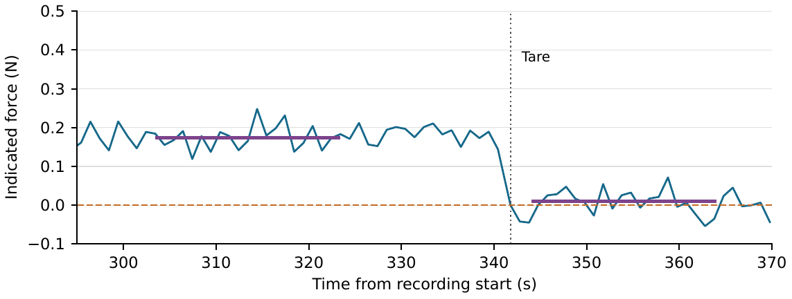

# Recording notes

## Acquisition and analysis records

The [firmware documentation](firmware/README.md#historical-firmware) lists the
historical build IDs, acquisition settings and the HX711 channel, gain and Uno
interface. The [data dictionary](DATA_DICTIONARY.md) defines the recorded fields,
analysis groups, temperature-probe assignments, units and noise-window calculation.
Static analysis windows are listed in [static_windows.json](analysis/static_windows.json).

## Reference scale and comparator fixture

The retail scale used for the CRW-7024 comparison was a CAS CL3000-P with
Max 15/30 kg and verification intervals of 5/10 g. All five objects lay in the
range with a 5 g interval; the maximum 1.7 g proportional-fit residual
was below half that interval. The triplicate indications are in
[reference_scale_check.csv](analysis/reference_scale_check.csv).

The comparator's observed sampling rate across the 26 loaded B records was
10.325-10.331 samples/s. The complete comparator fixture weighed 151 g, an upper
bound on the load-cell preload. Noise windows and rates are reported in
[comparator_noise.json](analysis/comparator_noise.json); their definitions are in
the [data dictionary](DATA_DICTIONARY.md#reproduced-interval-and-noise-summaries).

## Hand-press assembly and clock alignment

Series labels are synchronized presses (S), static controls on the same assembly
(SC), exploratory ramps (SX), and held-out test (B).

The centered hand-press series zeroed the CRW-7024 with the 343 g Hall assembly
in place. For synchronized presses, the same assembly rested on the 111 g
load-cell platform without mechanical fastening. Hand force was applied to the Hall
tray. A later setup check showed support deflection under load; its magnitude
during the recorded trials was not measured.

The `setup.description` in the preserved
[synchronized plan export](protocols/synchronized_press_plan.json) describes the
intended taped mounting, not the assembly used in these recordings. The actual
arrangement is described above.

Hand-loading observations ([HTML](docs/hand_loading_observations.html),
[PDF](docs/hand_loading_observations.pdf)) presents every
manual and synchronized press, the static controls and the ramp figure with their
methods. The manual scale readings were approximate and their timing relative to
the Hall windows was not independently verified. The synchronized setup did not
isolate the head response from support movement. These observations are not used
to quantify the force accuracy of the head itself or identify a friction mechanism.

Each device clock was mapped to host time by linear regression. The synchronized
records and alignment results are in
[synchronized_press.json](analysis/synchronized_press.json), with the calculation
in [reproduce_synchronized.py](reproduce_synchronized.py). Timestamp fields and
paired-capture links are defined in the [data dictionary](DATA_DICTIONARY.md).

## Embedded readout

The first calibration segment was extended to -50 g for signed zero display;
values below that threshold gave LOW status. The readout demonstration contained
unloaded intervals and 500, 1000 and 1502 g loads. The one-second calculations
were successive outputs from one demonstration.

| Check | Result |
|---|---:|
| Duration | 370.28 s |
| Calculations matching raw-sum recomputation | 369/369 |
| Sequence gaps / error flags | 0 / 0 |
| Unloaded mean before tare, 303.40-323.40 s | 0.173 N |
| Unloaded mean after tare, 344.03-364.02 s | 0.010 N |

The recorded outputs and checks are in [Nextion.json](analysis/Nextion.json);
[reproduce.py](reproduce.py) reproduces the readout calculation.
